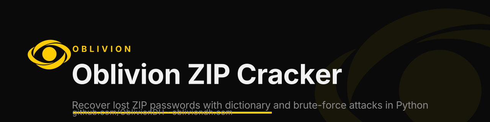

<p align="center">
  <a href="https://obliviondh.com"></a>
</p>

<h1 align="center">Oblivion ZIP Cracker</h1>

<p align="center">
  
  
  
  <a href="https://discord.gg/f4mZBU9xS8"></a>
</p>

<p align="center"><b>Recover lost ZIP passwords with dictionary and brute-force attacks in Python. Ethical password recovery by Oblivion.</b></p>

<p align="center">`zip` · `password-cracker` · `password-recovery` · `brute-force` · `dictionary-attack` · `python`</p>

---

Stay locked out no more! Built with Python, our Zip Password Cracker is dedicated to ethically recover lost or forgotten passwords of ZIP files. The tool not only underpins the significance of robust password practices but also accentuates the essentials of cybersecurity awareness.

~ By Oblivion Forgotten, an Ethical Hacker

## Features

Our Zip Password Cracker brings to the table a multitude of password regeneration techniques that cover all bases:

- **Brute-Force Attack**: This attack strategy uses brute force to pinpoint potential password combinations, catering to your length specifications.

- **Dictionary Attack**: This method utilizes a user-selected wordlist to unlock password recovery.

- **Hybrid Approach**: This technique couples wordlist components with suffixes to unleash maximum potential in password generation.

- **Random Password Generation**: Your password is decided by the draw of lots! Random passwords of user-defined lengths are generated.

- **Continuous Running**: The program is designed to experiement with different combinations until the correct password is found. No more manual retries!

## Usage Instructions

1. **Picking Up GitHub Code**: Clone our GitHub repository directly by entering the following in your terminal: `git clone https://github.com/ivanbg2004/oblivion-zip-cracker.git` and `cd oblivion-zip-cracker`.

2. **Installation**: For Python package requirements, refer to the 'Installation' section below.

3. **Running the Cracker**: The password cracker can be initiated through the shell script using the command: `chmod +x scripts/run_cracker.sh` followed by `./scripts/run_cracker.sh <path_to_zip_file> <max_length>`. Substitute `<path_to_zip_file>` with the path to your locked ZIP file and `<max_length>` with the maximum password length you want to attempt.

## Installation

Ensure that you have Python 3.x installed, and run the following commands:

```bash
python3 -m venv venv
source venv/bin/activate  # ATENTION!!! If you are on Windows use `venv\Scripts\activate`
pip install -r requirements.txt
```

## Contributing

Need to add more features or found some bugs? Contributions are welcome! Feel free to open an issue if you find one or create a pull request.

## Help and Support

If you encounter any problems or need help understanding the project, please open an issue. We'll be more than happy to assist you!

## License

The Zip Password Cracker falls under the MIT License. For more information, refer to the LICENSE file.

## Closing Notes

Designed with insights from ethical hacking and cybersecurity research, we hope to make a meaningful contribution to the community. Remember, with great power comes great responsibility. This tool should be used ethically and responsibly.

## Disclaimer and Ethics Reminder

This project evolved from a locally running successful program for the purpose of aiding users in the retrieval of forgotten zip passwords. Before being uploaded here, all files underwent some necessary editing for refinement and clarification; however, the essence and functionality of the program have been diligently preserved.

Best of luck in retrieving your lost passwords! In using this tool, we urge you to abide by a crucial guideline—only attempt to recover passwords for your own files. The illegitimate use of this tool for any other purpose, such as cracking others' passwords without explicit consent, is strictly prohibited and considered illegal.

Remember, as Spider-Man's Uncle Ben once said, "With great power comes great responsibility." Being our user, we trust you with this power to use our tool responsibly.

Looking forward to seeing you soon!

Best regards,
Oblivion Forgotten - An Ethical Hacker, promoting responsible and ethical hacking.


PD: This file and comments were made with AI so I have to study and work. On my free time I was with the code and then I used AI to comment it and also do the README.md file.


## ⚠️ Ethical use

Oblivion ZIP Cracker is built for **authorized security testing, education and CTFs only**. Use it only on systems you own or have explicit written permission to test. You are responsible for complying with all applicable laws. The authors accept no liability for misuse.

## About Oblivion

Built by [**Oblivion**](https://obliviondh.com) — cybersecurity, cloud and AI. This tool is part of the Oblivion open-source toolkit.

- 🌐 Website: [obliviondh.com](https://obliviondh.com)
- 🎓 Learn: [Oblivion Academy](https://academy.obliviondh.com)
- 💬 Community: [Discord](https://discord.gg/f4mZBU9xS8)
- 🔗 All links: [linktr.ee/ivanbg2004](https://linktr.ee/ivanbg2004)
- 👤 Author: [Ivan Barnola Gasch](https://www.linkedin.com/in/ivanbg2004/)

<sub>Keywords: zip, password-cracker, password-recovery, brute-force, dictionary-attack, python, ethical-hacking, cybersecurity.</sub>

<p align="center"><sub>© 2026 Oblivion. If this project helped you, leave a ⭐ — it helps others find it.</sub></p>
